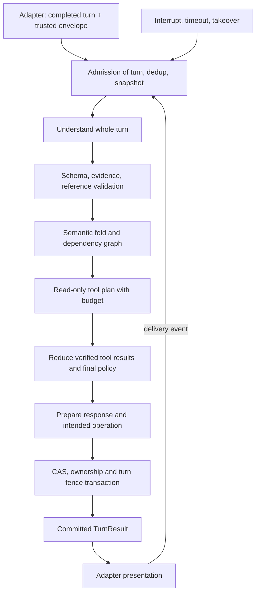

# Kế hoạch hợp nhất v3.0 — Viết mới toàn bộ lõi hội thoại ParrotGo

Mã: PG-CORE-REBUILD-003 · Ngày: 19/10/2026 UTC+7 · Trạng thái: **đặc tả chuẩn bị triển khai, chưa phát hành**.

Tài liệu này hợp nhất yêu cầu của `PLAN.md` v2.0, các tình huống/đề xuất trong `PLAN_BONUS.md`, đánh giá của phiên làm việc và các bảo vệ đang tồn tại trong ParrotGo. Các giải pháp mâu thuẫn được thay bằng quyết định có điều kiện, có oracle và có gate. [Truy vết](docs/12_SOURCE_TRACEABILITY.md) ghi rõ nguồn từng nhóm yêu cầu; [hai bản gốc](sources/README.md) được giữ nguyên.

## 1. Mục tiêu và giới hạn thay đổi

Viết mới lõi hội thoại dùng chung cho voice, Web text và CLI: nhận một lượt văn bản nguyên gốc cùng ngữ cảnh được xác thực; hiểu trọn lượt; xử lý hỏi đáp và thay đổi thông tin chuyến; gọi dịch vụ có giới hạn; ghi kết quả đúng quyền; trả các đoạn text cùng metadata cho adapter trình bày.

Phạm vi viết mới gồm SessionRunner implementation, NLU semantic boundary, domain state, reducer, planner, response composition, transaction coordinator và ports với dịch vụ. Có thể tổ chức lại graph và module; các hành vi an toàn không phụ thuộc code cũ vẫn phải được giữ. Việc xóa code cũ chỉ xảy ra sau compatibility/cutover và kiểm tra không còn caller.

ASR/VAD/ghép final, TTS/playback, LiveKit, browser, xác thực, admission, dashboard, provider transport và dữ liệu hiện hành là hệ thống tích hợp bên ngoài. Lõi có control events để đáp ứng interrupt/delivery/ownership nhưng không trực tiếp xử lý PCM hoặc mở micro. Các adapter được sửa có chủ đích để nối contract mới, giữ API công khai qua compatibility mapping.

Không tự tích hợp điều tài xế thật, thay provider vận hành, thay seed, đổi HTTP, chạy migration production, gửi dữ liệu khách tới model mới hoặc deploy trong tác vụ viết lại. Mỗi phần mở rộng có gate riêng. Hệ thống hiện chưa có dispatch production; kết quả SQLite không đồng nghĩa có tài xế nhận chuyến.

## 2. Định nghĩa hoàn thành

Lõi mới hoàn tất khi đáp ứng đồng thời:

1. Chạy chung một pipeline cho CLI/Web/voice adapters với schema versioned và contract tests; adapter không đọc graph/checkpoint/DB nội bộ.
2. Fixture profile deterministic với structured NLU proposals; sandbox hiểu text tự do bằng provider được chỉ định, effects mô phỏng và DB cô lập; connected giữ quyền nghiệp vụ được duyệt.
3. Xử lý đầy đủ đặt/đổi/hủy draft, câu nhiều ý, phủ định, hỏi xen ngang, lưỡng lự, recall và bàn giao, theo policy version đã pin.
4. Không đổi booking bởi pure inquiry; không xác nhận sai target/version; không submit trước khi xử lý xong self-correction toàn lượt.
5. Lưu dữ liệu gốc, evidence, revision, operation và response nhất quán; retry/resume không sinh đơn trùng; ngắt lời/worker cũ/operator takeover không ghi trái quyền.
6. Trả text thành công sau commit; TTS lỗi không đổi kết quả nghiệp vụ đã commit; sự kiện delivery tương quan đúng response/segment/playback.
7. Địa chỉ và FAQ/estimate có nguồn/precision đúng; thiếu dữ liệu được thể hiện rõ; policy chưa duyệt không tự bật.
8. Bộ acceptance chạy được trên engine mới với oracle độc lập, kiểm SQLite thật, event races/crash và kết quả thiếu bằng chứng được báo đúng.
9. Có bằng chứng so sánh baseline, budget/latency, compatibility, migration rehearsal và rollback; chưa có bằng chứng thì gate liên quan chưa đạt.

Hoàn tất tài liệu/schema không phải hoàn tất lõi. Kết quả xác thực gói chỉ chứng minh tài liệu/fixture nhất quán về mặt kiểm tra đã thực hiện.

## 3. Nguyên tắc kiến trúc

| Quyết định | Ràng buộc thiết kế |
|---|---|
| LLM | Adapter thay được; Qwen3.8-27B là ứng viên baseline từ nguồn, không phải lệnh đổi model production |
| Hiểu nghĩa | Một logical analysis toàn lượt, giữ thứ tự và scope; retry provider có budget, không dùng parser mock cứu live |
| State | Domain store là nguồn chuẩn; graph snapshot là projection/checkpoint có version và kiểm chứng |
| Reducer | Hàm xác định, không network, chỉ apply proposal đã validate và kết quả tool có schema |
| Planner | Chọn hành động theo state/policy/tool availability; xử lý toàn lượt trước thao tác có side effect |
| Công cụ | Typed ports và allowlist; dữ liệu retrieved/provider không có quyền sửa state hoặc chọn arbitrary endpoint |
| Persistence | Snapshot tính ngoài khóa; CAS + durable ownership + turn fence trong transaction |
| Response | Template-first cho nghiệp vụ; grounded generation tùy chọn cho giải thích; renderer không tự sửa booking |
| Delivery | Generated, committed và presented là các sự kiện khác nhau; confirmation phụ thuộc đúng câu hỏi |
| Compatibility | Facade giữ caller cũ trong chuyển đổi; schema/lệnh HTTP thay đổi phải có migration/version/đồng thuận riêng |

LangGraph tiếp tục là lựa chọn điều phối đề xuất vì repo đang dùng; không coi graph là nguồn chân lý thứ hai. Pydantic/JSON Schema kiểm shape; validator domain kiểm source, role, references và precondition. Tránh tạo nhiều bộ phân loại cạnh tranh hoặc gắn logic nghiệp vụ vào lời văn model.

## 4. Luồng một lượt

Tool calls có dependencies rõ. Có thể chạy các read-only task độc lập song song trong ngân sách; không song song hai thao tác thay cùng aggregate. Nếu cần tìm lại địa chỉ sau refinement, giới hạn chu kỳ và request; kết quả tool luôn gắn input/target/location_version. Response chứa claim giao dịch chỉ được cấp quyền delivery sau commit.

## 5. Các định danh và phiên bản

`session_id` là phiên kết nối/hội thoại; `request_id` là yêu cầu nghiệp vụ xuyên phiên; `draft_id` là bản nháp; `turn_id` là lượt đã admit; `input_id` là ID chống phát lại của adapter. `operation_id` định danh side effect; `response_id`/`segment_id`/`playback_id` định danh nội dung/lần trình bày. Không tái dùng một ID cho các vai trò khác nhau.

`state_version` phục vụ CAS, `booking_revision` phục vụ nội dung chuyến, `location_version` phục vụ địa điểm, `owner_generation` vô hiệu worker cũ, `turn_epoch` phục vụ cancellation trong một generation. Registry dữ liệu/prompt/policy có phiên bản riêng. [Contract](docs/01_CORE_CONTRACT.md) và [state machine](docs/02_CORE_STATE_MACHINE.md) quy định chi tiết.

Retry cùng input và cùng payload ngữ nghĩa nhận kết quả cũ; khác text/ngữ nghĩa cùng ID trả `INPUT_CONFLICT`. Evidence của lần admit được giữ, không nâng cấp xác nhận cũ chỉ vì delivery event đến muộn. Resume sang session mới giữ request và operation identity. Replay đã bị state mới vượt qua không được phát lại câu hỏi cũ.

## 6. Domain model và vòng đời

| Miền | Nội dung |
|---|---|
| ConversationState | focus theo scope, pending decision, bounded suspended context, unresolved issues, preferences, recent delivered history |
| BookingDraft | pickup, destination, stopovers, vehicle_type, passengers, pickup_time, contact reference, notes, booking_revision |
| LocationInput/Evidence | utterance refs bất biến, normalized components, hypotheses, candidates/rejections, provenance, precision, location_version |
| Turn/Operation | input identity, captured snapshot, status, lease/fence, intended effect, retry/reconcile result |
| DeliveryState | response/segment/playback, presented/partial/failed, question eligibility |
| Ownership | request generation, active owner, authorization scope; admission remains outer runtime |

`booking_status` nội bộ mới: `collecting`, `awaiting_confirmation`, `submitting`, `request_recorded`, `cancel_pending`, `cancelled`, `operator_required`, `submit_failed`. Trạng thái mô phỏng/thật được thể hiện bởi mode/provider/outcome; `request_recorded` không hàm ý dispatch. Mapping với `booking_pending/booked` legacy chỉ diễn ra trong compatibility adapter, không đổi ý nghĩa cho khách.

Slot availability tách khỏi verification và confirmation: missing, known, unknown_by_customer, declined, inferred_unconfirmed, not_applicable. Confirmation lưu chứng cứ riêng; không đặt confirmed vào knowledge_status. Một khách nói không biết không tự biến thành reject hoặc mất dữ liệu. Draft cancel/resume giữ ý định rõ ràng; thông tin đã hết hạn phải revalidate. [Policy matrix](docs/04_CORE_POLICY_MATRIX.md) quy định tính đủ điều kiện.

## 7. NLU, ontology và thứ tự ngữ nghĩa

Primary intents để thống kê gồm start/provide/change/confirm/deny/cancel/ask/chitchat/operator/repeat/control/pushback/unclear; quyền vận hành đi qua typed acts. Tên enum chuẩn nằm ở [NLU](docs/05_NLU_AND_CONTEXT.md), không dùng các label legacy khác nhau như hai bộ quyền.

Acts tối thiểu: request booking; set/replace/clear/merge component; confirm/reject pending; ask information; repeat/recall; set preference; decline/unknown; express uncertainty; request operator; social response. Mỗi act có source span, thứ tự, target/scope và dependencies. Model không tạo booking ID, coordinates, policy, target ID tự do hoặc công cụ tùy ý.

Những quy tắc bắt buộc:

- Pure question/repeat/recall/social/preference không mutate booking.
- “Thôi không đi A, đi B” là sửa đích theo scope, không tự hủy toàn chuyến.
- “Đúng rồi, nhưng đổi xe 7 chỗ” không submit summary cũ.
- “Đúng rồi, đón anh ở X” có thể xác nhận địa điểm đang hỏi thuộc target khác và thêm pickup, nếu binding/phiên bản còn hợp lệ; không xác nhận địa chỉ mới chỉ vì có từ đúng.
- “Đi Hải Phòng bao lâu, thôi đổi sang Hạ Long” giữ endpoint Hải Phòng của câu hỏi; draft cuối có thể Hạ Long. Mỗi question task pin referent ở đúng ngữ cảnh.
- “Thế á”, “hình như”, “khoan đã” không tự xác nhận giao dịch. Không có question hợp lệ thì lời đồng ý là acknowledgement.
- Từ phủ định bị mất hoàn toàn và text còn hợp nghĩa có thể không phát hiện được; oracle chấm theo thông tin quan sát được, không yêu cầu đọc ý định ẩn.

Văn bản gốc do server gán; normalized text/hypothesis là trường riêng. Normalizer deterministic chỉ chuẩn hóa có provenance, không viết lại ý định hoặc tự phục hồi một lệnh hủy bị nghi. `ignored_spans` là đề xuất phân đoạn, không xóa evidence safety khỏi audit hoặc bypass conflict checking.

## 8. Context, tham chiếu, lưỡng lự và lời nhắc

Reference resolution ưu tiên entity/role chỉ rõ trong câu hiện tại, sau đó focus còn hiệu lực, câu hỏi đã được trình bày và booking theo scope. Khi mơ hồ, hỏi một discriminator. “Đây” không phải GPS khi không có vị trí được cấp. Scope pickup/destination/inquiry khác nhau để chuyến liên tỉnh không bị tỉnh của endpoint này khóa endpoint kia.

Một offered decision tại một thời điểm. Pending có question/target/version, dependencies, expiry và delivery eligibility; ON_HOLD không có nghĩa giữ vô hạn hoặc nhận mọi “ừ”. Hỏi về B trong khi pending A không tự đổi booking; câu hỏi “giữ A hay đổi B?” đòi lựa chọn phân biệt, không dùng yes/no xác nhận A.

Express uncertainty giữ candidate như giả thuyết và thu evidence mới. Nếu evidence xung đột phải re-evaluate; không thuyết phục khách rằng mốc gần đó chứng minh đúng cơ sở. Sau đáp án, quay lại một câu hỏi phù hợp; đáp án dài có thể tạm hoãn quyết định với resume hook. Không buộc origin-first khi khách đang sửa/xác nhận destination.

Recall lấy immutable event log: user message trước current turn, bot text đã presented đúng channel, slot hiện hành và lịch sử sửa. Không dùng summary LLM làm bằng chứng nguyên văn; thiếu retention thì nói không còn dữ liệu. Preferences chỉ đổi cách trình bày; tốc độ TTS là yêu cầu adapter và phải được adapter xác nhận khả năng, không hứa text đã làm audio nhanh hơn.

## 9. Địa chỉ Việt Nam và chống nhiễu

Pipeline chuẩn: preserve raw → parse/normalize components → bounded alias/historical/phonetic hypotheses → catalog/provider candidates → hard compatibility filter → contextual rank → evidence/ambiguity/precision assessment → propose one/ask discriminator/record support/handoff. Từng bước giữ nguồn và phiên bản; provider trả rỗng không chứng minh địa chỉ ngoài đời không tồn tại.

Giữ đầy đủ số nhà, ngách/ngõ/hẻm/kiệt, đường, mốc và quan hệ gần/đối diện. Merge component phải idempotent, xử lý sửa đường/tỉnh làm mất dependencies cũ; không nối lặp raw qua retry. Per-utterance raw bất biến, merged label là projection riêng. Khẩu ngữ số, xuyệt, giờ tương đối và phương ngữ cần unit/gold tests; không đồng nhất mọi cấu trúc ngõ/ngách/hẻm.

Tên ngoại ngữ, letter entities và phonetic index tạo hypotheses. Catalog aliases đã review có scope; thương hiệu nhiều chi nhánh không map cứng. Prominence là soft feature sau hard constraints và rejection; không có luật Tier 1 luôn thắng Tier 4. Parent POI được ưu tiên khi khách gọi parent, child được giữ khi khách chỉ khoa/cổng/tòa/cửa hàng. Không dedupe chỉ bằng tên hoặc tọa độ vì parent/child có thể đồng vị trí.

Tách bốn trục: verified identity, pickup viable, destination sufficient, route estimable. Broad destination có thể giảm chi tiết hỏi theo policy; không tự chọn chi nhánh/khu đô thị hoặc lấy tâm hành chính thành nhà khách. Không suy tọa độ ngõ từ số ngõ gần nhau. Khách khẳng định địa chỉ chưa map được thì giữ nguyên và đi theo policy support, không tự đổi verification.

Có hướng dẫn đọc địa chỉ trên biển hiệu, hỏi mốc hoặc nhờ người xung quanh. Tìm cụm hai POI cạnh nhau là thử nghiệm có budget/dataset/uncertainty; cụm duy nhất trong tập kết quả không chứng minh duy nhất ngoài đời. Địa giới cũ/mới có hiệu lực thời gian và mapping nhiều-nhiều, không hardcode facts sáp nhập vào prompt. [Chi tiết](docs/06_LOCATION_AND_KNOWLEDGE.md).

Vietmap V4 qua adapter có contract tests Autocomplete/Place/Geocode/Route, giữ opaque ref ID và đơn vị. Chỉ gọi Place khi có cơ sở chọn candidate; cache có provider/terms/scope/version. API/license/quotas phải kiểm theo tài liệu chính thức khi tích hợp. Gói này không cam kết quyền crawl/lưu mọi dữ liệu hoặc API mới đã chạy đúng.

## 10. Ước lượng tuyến và giá

TripEstimate có khoảng distance/duration/fare, assumptions, endpoint version/precision, route provider, tariff version, retrieval time/expiry, known/unknown surcharge và quality. Cần nguồn route/tariff hợp lệ cho phần số được trả; thiếu tariff vẫn có thể trả distance/time nếu route đủ, không tạo tổng giá.

Fare engine theo biểu giá phân đoạn được duyệt: opening/km bands/time/waiting/toll/airport/tax và validity. Không mặc định phí chưa biết bằng 0. Không lấy khoảng tin cậy từ hệ số cộng tùy ý rồi gọi là xác suất; range phải phản ánh căn cứ. ETA hành trình khác ETA tài xế tới đón; chưa có dispatch thì không hứa thời gian xe đến.

Cache key gồm endpoint/version, vehicle, thời gian, provider, tariff/policy; edits ảnh hưởng phải invalidate. Giá đồng hồ và estimate không ràng buộc chỉ được nói nếu policy hãng được duyệt. Fixture estimate luôn demo-only, tách DB/config, có nhãn trong output. [Policy](docs/04_CORE_POLICY_MATRIX.md) và [module tri thức](docs/06_LOCATION_AND_KNOWLEDGE.md) quy định gate.

## 11. Knowledge, FAQ và policy

HARD_RULE thực thi trong validator/policy; OPERATING_POLICY có phê duyệt/version; FAQ là nội dung giải thích có facts/điều kiện; DYNAMIC_FACT cần nguồn cập nhật. Không dùng kết quả retrieval gần nghĩa để cấp quyền đặt/hủy hoặc thay sự thật live.

KnowledgeRecord cần record ID, status approved/draft/retired, owner/version, effective_from/to, scope brand/region/vehicle, source refs, answer facts, điều kiện và bản ngắn/dài đã duyệt. Retrieve → filter hiệu lực/scope → kiểm conflict/coverage → exact/template/grounded answer → claim/source validation. Missing/conflict trả chưa đủ bằng chứng hoặc hỗ trợ, không bịa.

Giữ adapter RAG hiện có khi tương thích; không thêm vector DB mới chỉ để khớp cấu trúc PLAN. Retrieved text là untrusted data, không thực thi chỉ dẫn nằm bên trong. Nguồn địa lý có thể thay đổi theo thời gian; câu hỏi y tế kiểu bệnh viện tốt nhất cần tránh tự kết luận chuyên môn, xác định nhu cầu và thông tin dịch vụ có nguồn.

## 12. Response, delivery và UI contract

Response segment có kind answer/question/terminal, exact text, response/segment IDs và metadata có schema. Một response tối đa một câu hỏi yêu cầu quyết định; có thể xử lý nhiều slot/câu hỏi thông tin trong cùng lượt. SINGLE_FOCUS không giới hạn số địa chỉ được trích xuất.

Template-first cho xác nhận/ghi nhận/lỗi; exact replay cho yêu cầu nguyên văn; grounded generation tùy chọn cho giải thích. Validate placeholder, số/ID/name và claims; không để LLM bù thiếu verified area. Lược context chỉ khi bỏ phần đó không làm hai địa điểm khác nhau thành cùng lời đọc. Văn bản hiển thị và speech nếu khác nhau phải có mapping, log đúng bản đã trình bày.

TTS failure không rollback booking. Commit failure không cho phát đoạn terminal thành công đã chuẩn bị. Filler/progress không tạo question eligibility, không thay answer hữu ích trong metric latency. [Đặc tả delivery](docs/07_RESPONSE_AND_DELIVERY.md).

## 13. Giao dịch, lỗi và khôi phục

Trong process: admit/dedup → capture snapshot/evidence → compute ngoài lock → validate whole turn → transaction kiểm owner/generation/turn status/CAS → ghi state/event/booking/task/outbox/response nhất quán → trả result. Không giữ DB lock trong lúc gọi model/map/RAG. Hủy thắng trước commit thì không có authoritative write; commit thắng thì reconcile, không tự hủy đơn.

External operation tương lai: persist operation identity và intent trước call; in-flight có owner lease; retry/reconcile cùng key; UNKNOWN không được submit key mới. Không hứa exactly-once khi provider không có idempotency/status query; nếu không đối soát được thì chặn thao tác và chuyển xử lý thủ công.

Error codes phải phân biệt invalid input, stale, conflict, schema/source/reference lỗi, provider timeout/auth/rate limit, map unavailable/not found, policy incomplete, persistence failure, unknown operation và ownership lost. Lỗi live giữ dữ liệu và khả năng thử lại; không tự dùng mock hoặc claim chưa được xác minh. [Giao thức đầy đủ](docs/03_CORE_TRANSACTION_PROTOCOL.md).

## 14. Chế độ chạy và CLI

| Profile | NLU | Maps/FAQ/estimate | Effects | Quyền |
|---|---|---|---|---|
| fixture | Structured deterministic proposal | Fixture có nguồn | Simulated, DB riêng | Test orchestration, không quảng bá hiểu tự do |
| sandbox | Provider thật được chỉ định | Fixture hoặc read-only live opt-in | Simulated, DB riêng | Manual chat và đo model có budget |
| connected | Cấu hình được duyệt | Provider hiện có | Intake SQLite theo policy; dispatch disabled mặc định | Mở tính năng theo gate |

Mode từng dịch vụ độc lập nhưng bundle validation phải chặn pha trộn fixture/live không có nhãn. Không tự đọc keys và bật live trong harness. CLI cùng core, commands dự kiến gồm chat, doctor, sessions, export, eval, generate, compare; chưa là lệnh có sẵn. Lệnh repo hiện có phải giữ tới khi compatibility được nghiệm thu.

REPL mục tiêu: `/help`, `/state`, `/history`, `/trace`, `/new`, `/reset`, `/resume`, `/export`, `/profile`, `/exit`; `//` escape slash. Commands không vào NLU; reset draft khác hủy booking; resume có xác thực, engine pin và generation. stdout lời thoại, stderr chẩn đoán đã redact, output JSONL cho input file. Không đặt PII trong export mặc định. Typer/Rich là lựa chọn UI, không ép đổi dependency chưa cần.

## 15. Test Factory và corpus

L1 seeds giữ text/context dependency; L2 contextual cases kiểm NLU/delta/action; L3 conversation scenarios kiểm nhiều lượt; L4 event timelines kiểm delivery/cancel/crash/takeover. [64 seeds](data/original-64.jsonl) giữ nguyên nguồn, không mặc định nhãn gợi ý là gold; câu ngắn/lặp có contexts khác nhau.

Semantic-first generation: chọn operations/preconditions → oracle độc lập → realize text → validate semantics/ambiguity → dedup theo lineage/split → review → freeze. M1 phương ngữ/số đọc, M2 phonetic, M3 mất từ/phủ định, M4 side-talk, M5 split-turn có oracle policy riêng. Clear equivalence mới giữ expected exact; ambiguous/irrecoverable phải cho hỏi lại/giữ state và cấm unsafe side effect phù hợp context. Không buộc đoán ý nghĩa đã bị mất.

Oracle exact cho state/version/call count/DB; invariant/metamorphic cho query/filler/retry; human rubric cho naturalness và facts khó. Không dùng chính model viết đáp án để chốt gold. Fixture NLU không đọc expected outputs/assertions để suy câu trả lời. Setup đạt mới được tính đã thực thi tình huống mục tiêu; giữ PASS/FAIL/ERROR/BLOCKED/NOT_RUN.

Số 150–250 seeds, 300–600 L2, 200–400 L3, 2.000–5.000 variants và gold300–500 từ PLAN là quy mô tham khảo, không gate giả. Coverage theo hành vi và rủi ro quan trọng hơn số biến thể. Baseline 1.000/100.000 tổ hợp trong repo không bằng số người dùng độc lập. [Acceptance](docs/08_TEST_FACTORY_AND_ACCEPTANCE.md).

## 16. Acceptance và đo chất lượng

P0 gate: 0 sai đặt/hủy, 0 stale write, 0 pure inquiry mutate, 0 claim thành công trước commit, 0 cross-account leak trong bộ đã khóa và thực thi đúng preconditions. Báo mẫu số từng nhóm và ca chưa chạy; zero trong mẫu không chứng minh zero rủi ro thực tế.

P1: entity/slot/act correctness, booking task success, geo false auto-accept/wrong parent, FAQ supported claims, recall exactness, clarification progress, retry/recovery. P2: style/độ ngắn, khả năng sử dụng. Latency core và end-of-speech→useful audio tách riêng; filler không là useful answer. Chi phí tính cả retry/query variants và phiên không hoàn tất.

Chạy offline logic → live read-only/model với effects mô phỏng được cho phép → audio integration 1/4 phiên → rollout cohort. Các kết quả lịch sử chỉ là baseline tham khảo; từng gate phải có manifest commit/data/prompt/policy/provider/time. Cấu hình 8s core/12s useful audio hiện tại là baseline cần đo lại, không là số đã đạt của engine mới.

## 17. Vận hành, bảo mật và cấu hình

Auth/admission/owner trust thuộc server. Raw user/retrieved/tool text không thể tạo timeout/takeover/delivery event hoặc arbitrary tool. Model output không được tự cấp verified, change schema, read secrets hay access request khác.

Log mặc định chỉ IDs, stage, enums, thời gian, version/hashes đã xem xét; không thêm địa chỉ, số liên hệ hoặc transcript khách. Debug protected tách quyền/retention và không xuất chain-of-thought. Export synthetic/eval tách operational evidence. Hash dữ liệu nhạy cảm không tự đảm bảo ẩn danh; dùng thiết kế fingerprint có kiểm soát.

Pin config/policy/prompt/catalog theo request; reload dữ liệu hiệu lực có migration/revalidation rõ. Deadlines truyền xuyên tool, retry dùng remaining budget, cooldown giữ tác dụng. Circuit breaker service không đổi mode. Thời gian tương đối neo input received_at + timezone; persisted UTC expiry khác monotonic timer. [Vận hành](docs/11_OPERATIONS_PRIVACY_OBSERVABILITY.md).

## 18. Tổ chức code đề xuất và compatibility

Tên module đích đề xuất `src/conversation/` với các phần application, domain, understanding, planning, response, ports và persistence adapter; đây là thiết kế, chưa tạo package hoặc đổi lệnh. Hạ tầng provider/maps/RAG có thể tái dùng qua ports nếu contract đúng, tránh sao chép HTTP pools/cache toàn cục.

Các entrypoint `src.web.server:app`, CLI/LiveKit cũ và facades cần adapter mỏng tới core service mới. Router không import server/global state; runtime Web vẫn ở app.state.runtime. Core engine identity pin theo durable request; session cũ giữ engine hoặc drain. Mọi mapping field/status có contract test và quyền rõ.

Không ghép schema mới vào DB bằng startup migration. Có thể dùng schema/prefix mới qua migration tường minh; booking/task/ownership/result có thẩm quyền phải ghi cùng transaction trong coexist. Chỉ read-model không có quyền quyết định nghiệp vụ mới được cập nhật bất đồng bộ/đối soát theo thiết kế được duyệt; không mở ngoại lệ best-effort cho critical writes. SQL trong gói chỉ minh họa source of truth/constraints. [Chuyển đổi](docs/09_MIGRATION_AND_CUTOVER.md).

## 19. Lộ trình triển khai theo gate

| Mốc | Bàn giao | Gate |
|---|---|---|
| R0 | Khóa contract, glossary, source of truth, policy baseline và corpus P0 | Review artifacts, schema/examples hợp lệ, quyết định mở có cách xử lý |
| R1 | Domain/reducer/state transitions và event model | Pure deterministic tests, causality/reference/invalidations |
| R2 | Atomic store/turn dedup/ownership/recovery | SQLite thật, concurrency/crash/idempotency tests |
| R3 | NLU port, full-turn proposals, context builder | SDK fixture lỗi/sources/references; live benchmark riêng nếu được phép |
| R4 | Geo/FAQ/estimate ports, evidence và budget | Số/ngõ/alias/parent/unknown không unsafe accept; no fabricated claims |
| R5 | Planner/renderer/delivery contract và adapter giả | Một offered decision, không confirm unheard, error/terminal đúng |
| R6 | CLI và compatibility Web/LiveKit/dashboard | Contract regression + event timelines; engine pin, no dual writer |
| R7 | Holdout/live/audio có budget và bằng chứng | Safety/quality/latency gates và migration rehearsal |
| R8 | Canary, quan sát, rollback, dọn code cũ | Dữ liệu mới không mất, cohort đúng, rollback tương thích |

Test Factory và oracle bắt đầu từ R0, không đợi cuối. [Backlog](docs/10_IMPLEMENTATION_BACKLOG.md) phân rã thành việc có phụ thuộc/acceptance/reversal. Engine chưa đủ safety hoặc policy không được duyệt thì vẫn phát triển sandbox, gate feature liên quan giữ đóng.

## 20. Rủi ro và điều kiện trước khi code

| Rủi ro | Biện pháp |
|---|---|
| Viết lại làm mất guard cũ | Baseline behavior mapping + P0 characterization, test through compatibility |
| Model tự sửa nhầm tên hoặc phủ định | Hypotheses riêng, source validation, ambiguity oracle và confirmation đúng target |
| Too many states/tools | Bounded workflow, typed contracts, no autonomous free tool loops |
| Hai nguồn state lệch nhau | Atomic domain store + derived graph snapshot, explicit recovery |
| Resume/dispatch tạo trùng | Durable request/operation identity, reconcile UNKNOWN, provider contract gate |
| Chấp nhận address mơ hồ | Policy matrix với conservative baseline và support path |
| Tối ưu điểm test thay chất lượng | Frozen holdout, independent oracle, denominator/prelude audit |
| Tăng latency/chi phí | Budget per-turn/session/provider, measurements cold/warm và 1/4 sessions |
| Mất dữ liệu khi rollback | Schema compatibility rehearsal; không restore backup cũ đè đơn mới |

Trước coding cần chốt kỹ thuật P0: service contract và ownership, source of truth, state/operation transitions, delivery protocol, identity/retry semantics, policy baseline và oracle. Các quyết định doanh nghiệp POL-01…POL-10 trong [registry](decisions/OPEN_DECISIONS.md) chưa được phê duyệt; feature liên quan có gate. Không dùng cấu hình demo, examples hoặc câu nhận xét của model để thay phê duyệt.

## 21. Checklist bàn giao cho coding agent

- Đọc README, toàn bộ chuyên đề P0 và AGENTS.md của repo đích trước sửa.
- Ghi ADR cho lựa chọn thay khác với đặc tả; cập nhật contract/tests trước đổi semantics.
- Dùng `.venv`, offline mock/map mock/RAG false trước import, DB/cache riêng `.tmp/` khi kiểm tra repo.
- Không gọi live, migration vận hành, deploy, commit/push nếu tác vụ triển khai chưa cấp phạm vi đó.
- Báo rõ file đã đổi, lệnh thật đã chạy, số pass/fail/blocked, baseline và giới hạn.
- Lưu báo cáo mới theo quy ước repo, không sửa lịch sử và không xóa bằng chứng cũ.
- Dùng [schema/examples](README.md) để bắt đầu validator/contract tests; examples là synthetic, không là benchmark đã đạt.
- Bàn giao từng mốc có rollback; không xóa lõi cũ trước khi callers và phiên cũ được xử lý theo kế hoạch.
