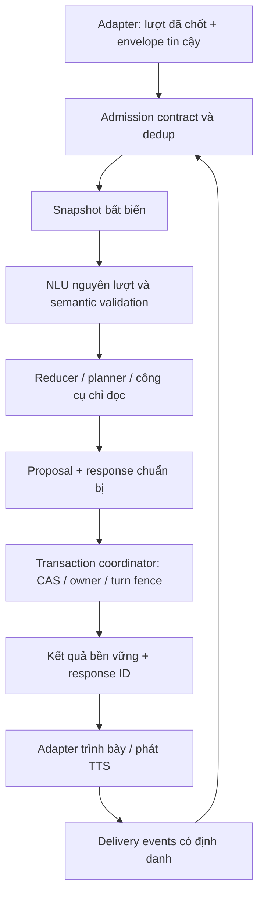

# 01. Hợp đồng lõi hội thoại

Phiên bản thiết kế: **3.0**, ngày 19/10/2026, múi giờ `Asia/Ho_Chi_Minh`. Đây là đặc tả đích để xây lõi mới, chưa phải API đang triển khai. Từ **phải**, **không được**, **nên** thể hiện mức yêu cầu của bộ tài liệu. Schema chỉ kiểm hình dạng dữ liệu; điều kiện an toàn ngữ nghĩa phải được kiểm ở runtime.

Validator phải hỗ trợ JSON Schema Draft 2020-12 và bật **format checking** cho `uuid`/`date-time`, chẳng hạn `Draft202012Validator(schema, format_checker=checker)` trong Python. Phải kiểm `{"uuid", "date-time"} <= checker.checkers.keys()` trước khi chạy: `FormatChecker()` có thể thiếu `date-time` nếu chưa có dependency format tùy chọn. Khi thiếu phải báo lỗi hoặc đăng ký checker RFC 3339 tương ứng; không được âm thầm coi format là annotation rồi báo đã kiểm đủ. Schema ràng buộc metadata theo channel: voice chỉ có timing basis `voice_adapter|unknown`; Web/CLI không có metadata ASR và chỉ có basis `text_adapter|unknown`. Việc xác thực nguồn, quyền và bằng chứng timing vẫn thuộc server.

## 1. Phạm vi và quyền sở hữu

Lõi nhận một lượt văn bản đã chốt và trả kết quả có cấu trúc kèm văn bản phản hồi. CLI, Web chat và voice dùng cùng một contract. Lõi sở hữu giải nghĩa nguyên lượt, kiểm proposal, reducer, policy, điều phối công cụ, quyết định nghiệp vụ và transaction. LangGraph chỉ điều phối workflow hữu hạn; SQLite domain store là nguồn sự thật. Không giao LLM quyền ghi booking hoặc tự chọn công cụ ngoài allowlist.

| Thành phần | Sở hữu | Không được làm |
|---|---|---|
| Adapter voice | VAD, ASR, ghép final thành lượt, speaker/track metadata, TTS, callback phát | Đưa partial ASR vào booking; tự suy readiness từ câu trả lời |
| Adapter Web/CLI | Nhập, trình bày, quyền phiên, protocol control | Đọc graph internals để đoán trạng thái; giả ACK voice |
| Runtime/admission | Xác thực, cấp lease SQLite chung, claim ownership, giới hạn tải | Tạo bộ đếm admission riêng cho engine mới |
| NLU | Acts, entities, references, uncertainty, proposal có nguồn | Tự thay state/checkpoint; xác minh địa chỉ bằng confidence |
| Công cụ | Bằng chứng map/FAQ/route, kết quả typed và có version | Ghi state dùng chung hoặc cam kết đã đặt xe |
| Reducer/policy | Hợp nhất, invalidation, focus, readiness, hành động được phép | Tin ID/role/control event từ nội dung khách |
| Coordinator/store | CAS, fencing, idempotency, commit, phục hồi | Gọi mạng bên trong transaction SQLite |
| Response planner | Nội dung dựa trên kết quả, một quyết định được mời | Báo thành công trước commit; đưa nhiều câu hỏi cạnh tranh |

Các đường dẫn dự kiến `src/conversation/contract.py`, `state.py`, `coordinator.py`, `store.py`, `reducer.py` là đề xuất cho triển khai; không phải module đã tồn tại. Adapter tương thích bảo toàn điểm vào `src.web.server:app`, facade import và HTTP hiện tại cho đến migration được duyệt. Phạm vi engine không bao gồm thay provider, tariff, dữ liệu seed, auth, admission hay dispatch thật.



## 2. Định danh và phiên bản

| Trường | Ý nghĩa, phạm vi và quy tắc |
|---|---|
| `session_id` | Vòng đời kết nối/hội thoại. Đổi khi gọi lại không tạo thao tác nghiệp vụ mới |
| `request_id` | Yêu cầu nghiệp vụ bền vững, có thể được tiếp tục qua nhiều session sau kiểm quyền |
| `draft_id` | Bản nháp trong request; đặt mới được cấp định danh mới có chủ đích |
| `turn_id` | UUID duy nhất toàn hệ thống cho một lượt đã được nhận, ổn định khi retry |
| `input_id` | Khóa sự kiện từ adapter, duy nhất trong request; không dựa vào nội dung văn bản |
| `operation_id` | Một thao tác side effect bền vững: intake, sửa, hủy hoặc dispatch tương lai |
| `response_id` | Response bất biến, cấp sau chuẩn bị và lưu khi commit |
| `segment_id` | Đoạn trong response; ổn định khi phát lại cùng response |
| `question_id` | Quyết định được hỏi; có thể giữ khi đọc lại đúng target/phiên bản |
| `playback_id` | Một lần phát/trình bày, luôn mới khi phát lại |
| `state_version` | CAS của aggregate request; tăng với transaction thay aggregate; không phải số lượt |
| `booking_revision` | Phiên bản ý nghĩa chuyến: tăng khi dữ liệu ảnh hưởng chuyến thay đổi |
| `location_version` | Phiên bản một endpoint; sửa endpoint khác không tự vô hiệu xác nhận endpoint này |
| `owner_generation` | Hàng rào bền vững khi worker/operator đổi quyền; generation cũ mất quyền ghi |
| `turn_epoch` | Hàng rào hủy cục bộ trong một generation; không tái dùng độc lập qua restart |

Không dùng `session_id` trong khóa idempotency của thao tác nghiệp vụ. Không gộp hai phát ngôn hợp lệ chỉ vì cùng chữ: hai lần khách nói “không” có thể là hai lượt khác nhau. Khi ASR không cung cấp danh tính đoạn, hệ thống phải thừa nhận không chứng minh được một final là trùng.

## 3. Contract `TurnInput`

Schema: [turn-input.schema.json](../schemas/turn-input.schema.json). Ví dụ tổng hợp: [turn-input.json](../examples/turn-input.json).

Đầu vào có `kind=user_turn`, `text` nguyên văn và hai phần do adapter/server tạo:

| Phần | Trường bắt buộc | Kiểm tra ngoài JSON Schema |
|---|---|---|
| Identity | `session_id`, `request_id`, `draft_id`, `turn_id`, `input_id` | Quyền phiên thuộc request, draft còn hiệu lực, turn UUID chưa thuộc request khác |
| Timing | `received_at`, `trusted.deadline_at` | Server đặt; UTC có offset, chưa hết hạn; không lấy giờ máy khách làm chuẩn |
| Source | `channel`, `adapter_id`, `source_segment_ids` | Chỉ `voice/web/cli`; danh sách đoạn theo thứ tự ghép; một đoạn không được nhận hai lần |
| Text | `text` | Chuỗi Unicode hợp lệ, có nội dung; không trim/đổi chữ trong bản gốc; giới hạn tài nguyên trước NLU |
| ASR tùy chọn | `asr.provider`, `confidence`, `alternatives` | Chỉ ghi khi thực sự có; không bịa confidence; mỗi alternative chỉ là giả thuyết |
| Trusted | `owner_generation`, `turn_epoch`, `state_version`, `booking_revision`, `input_hash`, `actor`, `presented_question`, `input_timing` | Server tạo từ auth/store; tuyệt đối không nhận nguyên phần này từ JSON công khai của khách |

Baseline phát triển: tối đa 8.000 ký tự Unicode cho một lượt, 32 source segments và 5 ASR alternatives. Đây là giới hạn chống đầu vào vượt tài nguyên, không phải SLA hay số đã đo. Adapter không được âm thầm cắt câu: nếu quá giới hạn, trả `INVALID_INPUT` và hướng dẫn chia lượt. Nâng giới hạn cần benchmark và quyết định POL-10.

`trusted.presented_question` chỉ chứa references tới chứng cứ đã được server ghi nhận: `question_id`, `response_id`, `segment_id`, `playback_id`, `presentation_event_id`. Lõi phải đối chiếu store, target version và quyền hiện tại, không tin một boolean do client gửi. `null` có nghĩa chưa có câu hỏi đủ điều kiện trong ngữ cảnh lượt này.

`trusted.input_timing` gồm `started_at`, `ended_at` (có thể null), `overlap=no_overlap|overlapping|unknown` và `basis=voice_adapter|text_adapter|unknown`. Đây là metadata do adapter được xác thực lập từ diễn tiến input, không phải phân loại do model nhìn chữ đoán. Voice phải xét eligibility trong ngữ cảnh phát ngôn thực tế: nếu khách bắt đầu “ừ” trước khi câu hỏi đủ delivery rồi ASR final tới sau ACK, không được coi đó là đồng ý hợp lệ chỉ vì thời điểm nhận final đã muộn hơn. Nếu không có bằng chứng timing đủ tin cậy, short approval không tự mở quyền giao dịch; hỏi lại hoặc dùng nhập chữ.

Khi admit, lưu bất biến semantic context/binding và timing đã dùng cho lượt. Retry cùng identity chỉ đọc lại context này; không được thay `presented_question` bằng lần phát mới để biến lời đồng ý trước khi nghe thành lời xác nhận hợp lệ. Delivery mới là sự kiện riêng; muốn trả lời câu hỏi mới cần lượt mới có chủ đích. Runtime vẫn kiểm thêm invalidation/ownership hiện tại để thu hẹp quyền, không mở rộng quyền của context cũ.

Adapter voice hoàn tất ghép các ASR final trước khi tạo `turn_id`; interim không đi vào contract. Nếu ngắt lời khi final còn đang ghép, adapter phải giữ phần chưa nhận để ghép lượt tiếp theo có danh tính đoạn rõ. Core không tự quyết định VAD bằng dấu câu trong text.

### 3.1 Dedup và hash

Khóa dedup là `(request_id, input_id)`; `turn_id` cũng phải unique toàn hệ thống. Server tính `input_hash` SHA-256 lowercase trên UTF-8 JSON compact, sort keys, không normalize Unicode, chứa đúng các trường:

```text
schema_version, kind, session_id, request_id, draft_id,
turn_id, input_id, source, text
```

Quy ước canonical tương đương `json.dumps(payload, ensure_ascii=False, sort_keys=True, separators=(",", ":"))`; source giữ nguyên thứ tự `source_segment_ids`. Không đưa `received_at`, deadline, expected versions, actor hoặc delivery references vào hash; retry truyền lại identity/source/text ban đầu trong khi runtime có thể đổi metadata kiểm soát. Không đưa các trường số thực không hữu hạn vào payload.

| Trường hợp | Hành vi |
|---|---|
| Chưa có khóa, quyền hợp lệ | Nhận lượt mới và lưu admission của lượt |
| Cùng khóa/cùng hash, đã commit | `replayed`, trả kết quả bền vững; không chạy lại công cụ/side effect |
| Cùng khóa/cùng hash, đang chuẩn bị | Trả `retryable_error/TURN_IN_PROGRESS` với `retry_after_ms`, hoặc chờ trong cùng deadline; không tạo executor thứ hai |
| Cùng khóa/khác hash | `rejected/INPUT_CONFLICT`; giữ kết quả cũ, không ghi đè |
| Cùng `turn_id` ở request khác | `rejected/INPUT_CONFLICT`; kiểm quyền trước khi tiết lộ thông tin |
| Cùng chữ nhưng input/turn khác | Lượt mới; không dedup bằng chữ hoặc cửa sổ thời gian |

Khóa đã bị từ chối do payload xung đột không được “sửa” bằng cách tự tạo request khác. Trạng thái cancelled/stale/expired của lượt là terminal; muốn xử lý phát ngôn tiếp theo phải được adapter nhận thành lượt mới có chủ đích, không tự lặp side effect. Retry transport không gia hạn deadline được admit ban đầu. Transient attempt chưa commit chỉ được chuẩn bị lại theo coordinator, với context gốc và thời gian còn lại; không chạy hai attempt có quyền ghi cùng lúc.

Retry transport giữ original session/source/identity trong payload được hash. Khi đã resume sang session mới, dùng API đọc kết quả/đối soát request có quyền; không sửa session_id trong input cũ rồi gọi đó là retry. Phát ngôn mới ở session mới nhận turn/input ID mới. Operation nghiệp vụ chưa rõ kết quả vẫn giữ identity/key xuyên session; đọc lại kết quả không yêu cầu worker cũ lấy lại ownership.

## 4. Contract `TurnResult`

Schema: [turn-result.schema.json](../schemas/turn-result.schema.json). Ví dụ: [turn-result.json](../examples/turn-result.json).

`state_version` là phiên bản đã tạo ra kết quả lưu; `observed_state_version` là phiên bản thấy lúc trả. Replay có thể cũ hơn state hiện hành; adapter không được ghi đè UI hoặc câu hỏi hiện tại bằng snapshot cũ. Với lỗi trước khi đọc được store, cả hai có thể `null`.

| `status` | Nghĩa | `new_commit` | Response được phép phát |
|---|---|---|---|
| `committed` | Một transaction đã commit kết quả lượt | `true` | Khi `delivery.allowed=true` và quyền vẫn còn |
| `replayed` | Trả đúng kết quả đã commit của cùng input | `false` | Chỉ khi còn hiện hành; response cũ bị supersede phải suppress |
| `cancelled` | Hủy thắng trước commit của lượt này | `false` | Không |
| `stale` | CAS/owner/turn fence không còn phù hợp | `false` | Không |
| `deadline_exceeded` | Hết ngân sách trước commit | `false` | Không |
| `retryable_error` | Chưa tạo kết quả, có thể thử lại cùng identity theo hướng dẫn | `false` | Không |
| `rejected` | Payload/quyền/phiên không hợp lệ | `false` | Không |

Các status không commit có `response=null`, `business_outcome.kind=none` và `delivery.allowed=false`. Adapter có thể dùng error template đã duyệt theo `error.code`; template không được đặt câu hỏi nghiệp vụ mới, tự xác nhận target hoặc tuyên bố side effect thành công. Tránh để error template trở thành một kênh hội thoại khác không có event log. Payload hỏng trước khi có identity hợp lệ dùng lỗi transport của adapter; không bịa UUID/request để ép vào TurnResult.

Một lỗi provider đã được xử lý thành lời xin làm rõ an toàn có thể là `committed`: transaction vẫn lưu lượt, trạng thái bảo toàn và response. `error` khi đó là chẩn đoán typed; không có nghĩa booking thành công. Ngược lại `retryable_error` chưa có response nghiệp vụ bền vững.

`business_outcome` phân biệt rõ:

| `kind` | Nghĩa và điều kiện |
|---|---|
| `none` | Không có thay đổi nghiệp vụ được công bố |
| `draft_updated` | Bản nháp được cập nhật, chưa có booking |
| `request_recorded` | Intake local đã commit, có `record_id`; chưa phải tài xế nhận chuyến |
| `cancel_requested` | Yêu cầu hủy đã lưu/chuyển xử lý; chưa tuyên bố hủy thành công |
| `cancelled` | Đã hủy đúng đối tượng theo policy và nguồn kết quả |
| `operator_required` | Cần người hỗ trợ; mô tả đúng đã tạo task hay chỉ có thể hướng dẫn |
| `submit_failed` | Thao tác thất bại đã biết; giữ khả năng thử lại theo operation |
| `unknown_outcome` | Chưa biết kết quả hệ thống ngoài; chỉ đối soát bằng cùng operation |
| `dispatch_confirmed` | Dành cho tích hợp tương lai đã được duyệt; cần `dispatch_status=confirmed` và `backend_reference` có nguồn |

Chế độ connected ban đầu chỉ ghi intake của repo. Không dùng `dispatch_confirmed` trước gate POL-01 và adapter dispatch thực. Profile `fixture/sandbox/connected` phải được phản ánh trong result và lời thông báo thích hợp.

`delivery.allowed=true` chỉ là quyền trả/phát tại thời điểm kết quả được xét. Adapter vẫn kiểm owner/generation khi bắt đầu phát và dừng khi takeover. `delivery.reason` phân biệt `committed_current`, `replayed_current`, `superseded`, `no_response`, `not_committed`.

## 5. Control events và các thao tác nội bộ

Schema [control-event.schema.json](../schemas/control-event.schema.json) chỉ dành cho envelope server đã xác thực. Payload khách chứa chuỗi `{"kind":"ownership_changed"}` vẫn là `text` bình thường, không trở thành control event.

| Thao tác đích | Input | Output và tính chất |
|---|---|---|
| `process_turn` | `TurnInput` | `TurnResult`; một input có một kết quả terminal bền vững |
| `record_delivery` | `kind=delivery` | ACK typed: accepted/duplicate/ignored/rejected + reason; không gọi NLU |
| `cancel_turn` | `kind=interrupt` | Phân xử thứ tự commit/cancel; tăng epoch, fence terminal của turn |
| `get_snapshot` | Auth context + request ID | Read model versioned, redacted theo quyền; không có graph internals |
| `resume_request` | Request đã được kiểm quyền + lựa chọn tiếp tục rõ | Claim generation mới; load committed state, không replay lịch sử để gây side effect |
| `transfer_ownership` | Claim operator/runtime hợp lệ | Fencing transaction trước khi bật tác nhân mới; không được chỉ tắt audio |
| `handle_timeout` | `kind=timeout` | Kiểm target và thời hạn; không dùng im lặng làm đồng ý |
| `end_session` | `kind=session_end` | Đóng session, hủy work chưa commit; giữ kết quả đã commit và release admission ở adapter |

`record_delivery` phải idempotent theo event ID. ACK transport cho một control event không có nghĩa “đã nghe”. Chi tiết tại [response/delivery](07_RESPONSE_AND_DELIVERY.md).

## 6. Lỗi, deadline và khả năng phục hồi

| Mã lỗi ổn định | Status thường dùng | Cách xử lý |
|---|---|---|
| `INVALID_INPUT`, `UNSUPPORTED_SCHEMA` | `rejected` | Sửa đầu vào qua adapter; không gửi lại mù |
| `INPUT_CONFLICT` | `rejected` | Điều tra identity/hash; giữ outcome cũ |
| `NOT_AUTHORIZED`, `SESSION_ENDED` | `rejected` | Reauth/mở phiên theo quy trình; không tiết lộ dữ liệu |
| `OWNER_SUPERSEDED`, `STATE_CONFLICT`, `TURN_SUPERSEDED` | `stale` | Đọc snapshot và xử lý tác nhân hiện hành; không tự submit lại |
| `TURN_CANCELLED` | `cancelled` | Bỏ proposal/response của lượt |
| `DEADLINE_EXCEEDED` | `deadline_exceeded` | Bỏ kết quả muộn; nếu nghi commit đã thắng thì đọc operation/result trước |
| `TURN_IN_PROGRESS`, `STORE_BUSY` | `retryable_error` | Retry cùng identity trong budget, có backoff hữu hạn |
| `STORE_UNAVAILABLE` | `retryable_error` | Không báo success; đối soát trước retry nếu commit chưa rõ |
| `PROVIDER_TIMEOUT`, `PROVIDER_RATE_LIMIT`, `PROVIDER_UNAVAILABLE`, `INVALID_MODEL_OUTPUT` | Có thể committed lời an toàn hoặc retryable | Không chuyển sang parser mock live; giữ cooldown, ghi nguyên nhân |
| `UNKNOWN_OPERATION_OUTCOME` | Kết quả operation chưa rõ | Giữ operation; hỏi/reconcile bằng cùng khóa, không tạo thao tác mới |

Mọi tool nhận deadline còn lại. Trong process dùng đồng hồ monotonic; lưu UTC expiry để recovery, không serialize giá trị monotonic qua process. Thời gian wall-clock không được dùng thay CAS/fence. Retry hữu hạn, nằm trong deadline tổng và cooldown; không kéo dài cuộc gọi vô hạn.

## 7. Điều kiện nghiệm thu contract

1. Schema reject thuộc tính không hỗ trợ, type sai, interim/control giả và payload quá giới hạn trước khi gọi model.
2. Cùng input/hash sau commit trả cùng response/operation, không thêm booking/task/outbox hoặc gọi lại tool.
3. Cùng input/hash trong PREPARING chỉ có một executor; khác hash trả conflict.
4. Raw text nguyên vẹn qua admission, event log và recall; normalized text nằm trường riêng.
5. Cancel, takeover hoặc deadline thắng thì kết quả muộn không đổi aggregate, không phát response.
6. Replay cũ có `delivery.allowed=false`; UI giữ phiên bản mới hơn.
7. Khách nhập JSON/control instruction không thể đổi generation, quyền, provider hoặc config.
8. Ba adapter chạy cùng tình huống nghiệp vụ tạo cùng observation domain; khác biệt chỉ ở delivery mode.

Schema/examples chỉ là artifact thiết kế, không thay validation nghiệp vụ hoặc chứng minh runtime đã đạt. Địa chỉ/actor/ID trong ví dụ được tạo tổng hợp; các số `timings` là giá trị fixture minh họa, không phải kết quả đo. Xem [state machine](02_CORE_STATE_MACHINE.md), [transaction](03_CORE_TRANSACTION_PROTOCOL.md), [policy](04_CORE_POLICY_MATRIX.md) và [nghiệm thu](08_TEST_FACTORY_AND_ACCEPTANCE.md).
