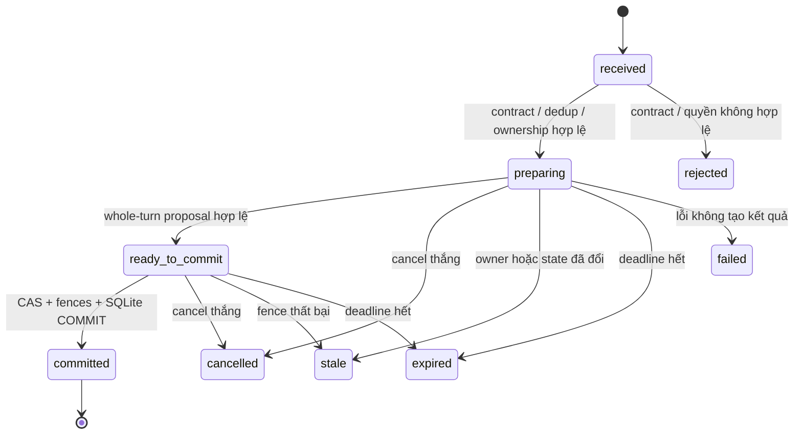

# 02. Mô hình state và luật chuyển trạng thái

Thiết kế đích 3.0, ngày 19/10/2026. Tài liệu này chốt semantics trước khi viết reducer mới. Các trạng thái là tên nội bộ đích; không tự đổi enum HTTP/DB của repo. Adapter tương thích và migration ở [kế hoạch chuyển lõi](09_MIGRATION_AND_CUTOVER.md) phải ánh xạ tường minh.

## 1. Aggregate và bất biến

Đơn vị CAS là **request**, không phải graph thread hoặc cuộc gọi. Một request có draft hiện hành, ownership, các phiên liên kết và event sequence. Một người có thể có nhiều request hợp lệ; quyền truy cập phải được kiểm riêng, không suy từ số điện thoại hay tên trùng.

| Miền state | Dữ liệu chính | Nguồn có thẩm quyền |
|---|---|---|
| `ConversationState` | Focus theo endpoint, câu hỏi được mời, ngữ cảnh tạm giữ, preferences, vấn đề chưa giải quyết | Reducer từ event/proposal hợp lệ |
| `BookingDraft` | Origin, destination, vehicle 4/7 chỗ, số khách, giờ, điểm dừng, ghi chú, revision | Reducer/policy; operator qua transaction được kiểm quyền |
| `LocationEvidence` | Các phát ngôn nguồn, components chuẩn hóa, hypotheses, candidates, bằng chứng/verification | Công cụ trả evidence, reducer quyết định áp dụng |
| `TurnState` | Identity/hash, phase, snapshot version, deadline, owner, operation/result refs | Coordinator/store |
| `OperationState` | Loại thao tác, khóa chống lặp, trạng thái kết quả, số lần đối soát | Transaction coordinator và adapter kết quả |
| `DeliveryState` | Response, segment, playback attempts, output availability, eligibility | Control events đã xác thực |
| `Ownership` | Chủ sở hữu, durable generation, lease/ref, local turn epoch | Runtime/operator claim trong transaction |

Các bất biến bắt buộc:

- Chỉ reducer/policy hợp lệ quyết định slots, semantic revision và readiness. Proposal không phải state.
- Event khách nguyên văn bất biến; không nối nội dung vào `raw_text` rồi giả là một phát ngôn.
- Một lượt chỉ hỏi/recall/style/xã giao không đổi booking slots hoặc `booking_revision`.
- Focus thông tin không tự trở thành destination. `unknown`, `declined`, `missing` là ba tình trạng khác nhau.
- Một candidate chỉ được chọn trong đúng role/version và không thuộc tập bị bác; chọn candidate chưa có nghĩa đã xác minh.
- Một response mời tối đa một quyết định. Trả nhiều câu hỏi thông tin có thể gồm nhiều câu trả lời, nhưng chỉ một lời mời ra quyết định tiếp theo.
- Xác nhận phải gắn target version, đúng câu hỏi đủ điều kiện delivery và còn hiệu lực khi xét toàn lượt.
- Booking thành công chỉ được công bố sau transaction có thẩm quyền commit; local intake khác dispatch.
- Cancellation, owner generation và CAS có quyền phủ quyết mọi kết quả chuẩn bị cũ.

## 2. Các phiên bản tăng khi nào?

| Sự kiện | `state_version` | `booking_revision` | `location_version` |
|---|---|---|---|
| Lưu lượt xã giao, đổi preference/focus/câu hỏi | Tăng nếu aggregate thay đổi | Giữ | Giữ |
| Sửa origin có ý nghĩa | Tăng | Tăng | Origin tăng |
| Sửa destination có ý nghĩa | Tăng | Tăng | Destination tăng |
| Bổ sung số nhà/ngõ/mốc ảnh hưởng nơi đón | Tăng | Tăng | Origin tăng; tính lại evidence |
| Sửa vehicle/passengers/time/stops/note ảnh hưởng thực thi | Tăng | Tăng | Endpoint liên quan tăng nếu bị thay đổi |
| Tool trả evidence cho cùng location | Tăng khi được nhận vào state | Chỉ tăng nếu thay nội dung chuyến hoặc lựa chọn có ý nghĩa | Tăng khi target được hỏi không còn cùng nghĩa/bằng chứng |
| Retry cùng input đã commit | Không có commit mới | Giữ | Giữ |
| Delivery event thuần túy | Ghi event/delivery store | Giữ | Giữ |
| Owner takeover | Tăng generation; tăng state_version nếu aggregate đổi | Giữ khi nội dung chuyến chưa đổi | Giữ |

Counter phải monotonic, không gán lại bằng số lượt. Các event delivery độc lập có sequence riêng; không bắt toàn bộ tool proposal bị stale chỉ vì telemetry ACK đến. Nhưng eligibility luôn được đọc lại ở commit. Phân chia transaction này phải giữ CAS/fencing trong [giao thức lưu](03_CORE_TRANSACTION_PROTOCOL.md).

`values_digest` của summary là hash canonical các giá trị cần khách xác nhận và policy version. Không bao gồm response wording, timestamp trình bày hoặc trace ID. Thêm chi tiết có thể làm thay summary dù nhãn đường không đổi.

## 3. Vòng đời một lượt



Sơ đồ trên mô tả phase logic. SQL minh họa lưu `received` thành `admitted`, `ready_to_commit` vẫn là `preparing` kèm prepared object chưa có quyền ghi, `expired` thành `deadline_exceeded`, và attempt lỗi có thể phục hồi thành `retryable_error`. Không thêm enum công khai chỉ để giống sơ đồ. `replayed` là kết quả đọc lại, không phải phase mới của turn. Retryable failure không được làm mất bằng chứng rằng turn đã commit. Nếu SQLite trả lỗi mà chưa chắc COMMIT đã thắng, phải đọc lại turn/result theo identity trước khi báo chưa có thao tác. Không chạy graph lại để “đoán” commit.

### 3.1 Phân xử sự kiện đồng thời

| Cặp sự kiện | Thứ tự có thẩm quyền | Kết quả |
|---|---|---|
| Cancel và commit | Fence/transaction được lưu trước | Cancel thắng: không ghi proposal; commit thắng: giữ kết quả, đối soát delivery |
| Hai turn dùng cùng state snapshot | CAS commit đầu tiên | Turn sau stale, không tự rebase và submit |
| Takeover và AI commit | Durable owner generation | Chủ cũ không được ghi dù task/provider vẫn chạy |
| Deadline và provider result | Kiểm deadline tại commit | Kết quả quá hạn bị bỏ, trừ commit đã thắng và cần reconcile |
| Old delivery ACK và câu hỏi mới | Response/playback/generation hiện hành | ACK cũ không làm câu hỏi mới eligible |
| Session ended và kết quả booking đã commit | Trạng thái operation bền vững | Không xóa booking; giữ khả năng thông báo lại có kiểm quyền |

Local `turn_epoch` bảo vệ task trong cùng owner generation. Cancel phải ghi phase fence của turn dưới coordinator lock/transaction trước khi công bố hủy đã thắng. Sau restart, generation bền vững và phase terminal là căn cứ; không phục hồi số monotonic/epoch cũ như một quyền ghi.

## 4. Vòng đời yêu cầu đặt xe

Tên enum đích: `collecting`, `awaiting_confirmation`, `submitting`, `request_recorded`, `cancel_pending`, `cancelled`, `operator_required`, `submit_failed`.

| State hiện tại | Sự kiện và điều kiện | State kế tiếp | Side effect được phép |
|---|---|---|---|
| collecting | Đủ slots và evidence theo policy | awaiting_confirmation | Tạo summary/question, chưa intake |
| collecting | Khách chưa biết thông tin bắt buộc | collecting/operator_required | Hỏi dấu hiệu hữu ích hoặc hỗ trợ đúng khả năng |
| awaiting_confirmation | Sửa dữ liệu chuyến | collecting/awaiting_confirmation | Invalidate trip confirm; chuẩn bị summary mới |
| awaiting_confirmation | Confirm đúng summary đã trình bày, không có edit xung đột trong nguyên lượt | submitting | Chuẩn bị operation theo khóa bền vững |
| submitting | Intake local COMMIT thành công | request_recorded | Booking/task/outbox/response cùng transaction |
| submitting | Thất bại chắc chắn, chưa ghi booking | submit_failed | Giữ draft, error và operation để retry đúng |
| submitting | Kết quả hệ thống ngoài chưa rõ | submitting | Operation ở unknown; chỉ reconcile |
| submit_failed | Retry rõ ràng, dữ liệu/confirm còn hợp lệ | submitting | Cùng operation nếu cùng nghiệp vụ; không tự tạo key mới |
| collecting/awaiting_confirmation | Hủy draft có scope rõ | cancelled | Không xóa lịch sử; không gọi cancel dispatch |
| cancelled | Khách muốn tiếp tục | collecting sau lựa chọn reuse/new | Không tự submit; kiểm lại time/evidence và ownership |
| request_recorded | Yêu cầu sửa/hủy sau intake | cancel_pending hoặc giữ request_recorded | Theo POL-05, baseline tạo operator task có nguồn |
| cancel_pending | Kết quả hủy chắc chắn | cancelled | Lưu audit và kết quả trước khi thông báo |
| cancel_pending | Từ chối/lỗi hủy | request_recorded | Giữ bản ghi còn hiệu lực, nói rõ chưa hủy |
| active | Handoff cần thiết và khả dụng | operator_required | Tạo task/claim đúng policy; không giả đã kết nối |

Với intake local đồng bộ, `submitting` có thể chỉ là bước logic bên trong một transaction; không cần phơi state trung gian chưa commit. Với backend ngoài, operation bền vững phải được chuẩn bị trước network. `unknown_outcome` thuộc operation; không thêm trạng thái “đã đặt” giả để lấp chỗ trống.

Một request mới chỉ được tạo theo ý định/consent rõ, không dùng request mới để né cancel hoặc dedup. Sau intake, sửa bản nháp không tự sửa booking đã ghi. Bản recorded và proposed modification tách biệt để không báo cho khách giá trị chưa có hiệu lực.

## 5. Slot và readiness

Mỗi slot có `value`, `knowledge_status`, `provenance`, `confirmation` và validation state. `knowledge_status` dùng `missing|known|unknown_by_customer|declined|inferred_unconfirmed|not_applicable`; confirmation là chứng cứ riêng, tránh gộp tất cả vào một enum.

Readiness là kết quả hàm tất định trên draft + location evidence + policy version + operation state, gồm:

```text
missing_requirements[]
blocking_evidence[]
pending_required_confirmations[]
allowed_next_actions[]
can_offer_trip_confirmation
can_record_request
can_dispatch
```

`can_record_request` chỉ true sau xác nhận phù hợp; không đồng nhất với “đủ để hỏi xác nhận”. `can_dispatch=false` ở baseline vì chưa có dispatch adapter. Destination bắt buộc, xe chỉ 4/7 chỗ, địa chỉ chưa xác minh chặn automatic intake cho tới policy được duyệt khác. Không ép hỏi origin trước nếu khách đang trả lời destination; chọn câu hỏi thiếu có ích nhất theo focus và chi phí làm rõ.

`pickup_sufficient`, `destination_sufficient`, `route_estimable`, `verified` phải là các đánh giá độc lập có lý do. Một area có thể đủ ước lượng sơ bộ nhưng chưa đủ booking. Model không được tự chuyển `unknown_by_customer` thành `not_applicable`.

## 6. Fold toàn lượt và xử lý xung đột

Reducer hoạt động theo hai pha: **tính kết quả dự kiến** và **cấp phép tác động**. Không thực thi lần lượt các act có side effect khi mới duyệt prefix.

1. Hiểu nguyên câu, lưu act order/source spans và task references.
2. Validate schema, provenance, phủ định, referent và scope; proposal thiếu căn cứ chỉ tạo uncertainty.
3. Resolve reference vào snapshot đủ điều kiện, không cho model cấp ID tùy ý.
4. Fold edits theo thứ tự trong cùng scope; correction sau thay correction trước của cùng slot.
5. Tính versions và dependency invalidation trên kết quả toàn lượt.
6. Xét confirm/reject với target đã bind và mọi edit cùng lượt.
7. Resolve cancel/resume/handoff theo scope; tạo action plan hữu hạn.
8. Chạy công cụ chỉ đọc cần thiết, reconcile evidence có source, kiểm invariant/readiness lại.
9. Planner tạo response dựa trên kết quả; coordinator mới được commit/side effect theo prerequisites.

| Phát ngôn tổng hợp | Kết quả bắt buộc |
|---|---|
| “Đúng rồi, nhưng đổi sang xe 7 chỗ.” khi chờ xác nhận chuyến | Sửa vehicle, tăng revision, cần summary mới; không submit theo prefix |
| “Đúng rồi, đón tôi ở Keangnam.” khi hỏi destination | Có thể confirm destination cũ nếu eligible; cập nhật origin độc lập, chưa confirm toàn chuyến |
| “Đúng rồi, nhưng số nhà là 28.” khi hỏi origin | Sửa cùng endpoint; confirm cũ vô hiệu, cần xác minh/xác nhận bản mới |
| “Hạ Long, à không, Hải Phòng.” khi hỏi destination | Destination cuối Hải Phòng; không tạo booking trung gian Hạ Long |
| “Không phải chỗ đó, đón ở viện E.” | Reject đúng candidate, đề xuất origin mới; không cancel request |
| “Thôi không đặt nữa, Bích Động thuộc đâu?” | Hủy đúng draft, trả question task có referent Bích Động; không đặt destination Bích Động |
| “Bệnh viện 103 nằm đâu? Tôi vẫn đi 108.” | Tra 103 và giữ destination 108; task lookup không bị đổi thành 108 |
| “Đặt đi” sau draft cancelled | Mời reuse/new hoặc tiếp tục theo consent cụ thể; không submit ngay |
| “Ừ đúng rồi” sau câu hỏi “giữ 108 hay đổi 103?” | Chưa chọn phương án; hỏi rõ, không hồi sinh pending cũ |
| “Hình như thế, để tôi xem lại.” | Uncertainty, giữ ứng viên cần kiểm; không confirm chuyến |

Cancel có scope được ưu tiên ngăn submit, nhưng không được xóa các câu hỏi độc lập. “Không đi Hạ Long nữa, đi Hải Phòng” là replacement, không tự cancel cả request. Nếu cancel và resume trong cùng câu có nhiều cách hiểu, giữ draft và hỏi ý định thay vì chọn tác động lớn nhất.

## 7. Địa chỉ phân mảnh

`MERGE_SLOT_COMPONENT` là proposal **component-level**, tên chuẩn của ý tưởng `APPEND_OR_REFINE_SLOT` trong nguồn BONUS. Đích và operation phải rõ: bổ sung phần thiếu, sửa phần cũ hay đổi hẳn địa điểm. Không dùng nối chuỗi vô điều kiện.

| Tình huống | Merge |
|---|---|
| Lượt 1 số nhà/ngách, lượt 2 ngõ/đường cùng endpoint | Ghép components có nguồn; raw utterance mỗi lượt giữ riêng |
| Lượt 2 thay số nhà | Thay đúng component; giữ địa bàn nếu còn tương thích; revalidate |
| Lượt 2 đổi đường | Không giữ số ngõ/ngách cũ nếu không có bằng chứng còn áp dụng; hỏi lại phần phụ thuộc |
| Bổ sung mốc cho tài xế | Lưu landmark/relation và driver note; không suy tọa độ đã xác minh |
| Retry cùng input | Không nối lại lần hai, không tăng revision lần hai |
| Chi tiết mâu thuẫn tỉnh/thành | Không trộn; hỏi rõ endpoint hoặc địa bàn đúng |

Số nhà/ngõ/ngách giữ cấu trúc; “hẻm”, “kiệt”, “xuyệt” không phải mọi nơi đều tương đương. Thêm component ảnh hưởng điểm tiếp cận làm thay location_version, tính lại verification và xác nhận liên quan. Không giữ confirm chỉ vì tên đường vẫn giống.

## 8. Focus, câu hỏi pending và ngữ cảnh tạm giữ

Một `offered_question` hiện hành có `question_id`, kind, target, versions/digest, response/segment refs và presentation evidence. Danh sách `suspended_contexts` tối đa 4 mục trong baseline phát triển, có lý do, target version, created/expiry và trạng thái; không phải stack vô hạn. Giới hạn này có thể chỉnh qua POL-10 sau đo, không âm thầm bỏ quyết định chưa giải quyết.

| State câu hỏi | Ý nghĩa | Được nhận short confirmation? |
|---|---|---|
| prepared | Tạo nội dung, chưa commit | Không |
| offered | Response đã commit, chưa đủ delivery | Không |
| eligible | Đúng lần trình bày đủ điều kiện và target hiện hành | Có nếu nguyên lượt xác nhận rõ |
| on_hold | Khách hỏi/lưỡng lự, target chưa đổi | Chỉ khi target vẫn được xác định rõ và không có câu hỏi mới cạnh tranh; cần re-offer nếu không rõ |
| invalidated | Target/version/owner không còn phù hợp | Không |
| resolved | Đã confirm/reject/choose | Không; không dùng lại cho lượt sau |
| expired | Quá hạn/resume khác session | Không; đọc lại bằng response mới |

Hỏi thông tin về chính candidate có thể tạm giữ pending, trả lời và mời lại cùng quyết định trong **response mới**. Hỏi địa điểm khác cập nhật information focus; không tự đổi booking nhưng có thể làm short “đúng rồi” không còn referent đơn nhất. Explicit referent trong câu khách ưu tiên hơn pending suy đoán.

Lược địa bàn khi đọc phải dựa trên unambiguous common context theo từng endpoint. Nếu có nhiều chi nhánh/tỉnh hoặc context vừa đổi, đọc đủ phần phân biệt. Không triển khai “mỗi lượt chỉ một địa chỉ” theo nghĩa bỏ qua endpoint thứ hai khách đã nói rõ; giới hạn một quyết định không giới hạn số dữ liệu được tiếp nhận.

## 9. Resume và lịch sử

Resume chỉ tải committed request sau xác thực, kiểm operator audit, generation và lựa chọn tiếp tục/đặt mới. Kiểm lại giờ đón đã qua, evidence/policy hết hiệu lực và trạng thái booking. Không restore eligibility từ session cũ; reissue response/playback mới. `question_id` chỉ có thể giữ nếu quyết định/target chưa đổi.

Recall phân biệt `last_user_before_current`, `last_presented_assistant`, `last_generated_assistant`, giá trị booking hiện tại và lịch sử trước sửa. Mặc định câu “bạn vừa nói gì?” lấy phần đã trình bày theo delivery mode, không lấy text chuẩn bị hoặc phần chưa phát. Nếu dữ liệu thiếu, nói thiếu dữ liệu; không dùng model tái dựng ký ức. Không lấy chính câu “nãy tôi nói gì?” làm user message cần nhắc.

## 10. Gate kiểm thử reducer

- Test bảng transition và dependency invalidation độc lập với LLM, có fixtures rõ.
- Test property: pure query không đổi booking; merge retry bất biến; reorder independent acts tương đương; same-slot correction có thứ tự.
- Test mọi confirm kèm edit ở cùng endpoint/khác endpoint/toàn chuyến; stale references bị từ chối.
- Test timeline cancel/commit/takeover/restart; side effect count không vượt operation được cấp.
- Test resume không replay booking và không restore delivery eligibility.
- Test pending hold không nuốt explicit referent hoặc chọn hộ ở câu hỏi hai phương án.

Các tests là yêu cầu triển khai, chưa có kết quả runtime mới. Dữ liệu và oracle tại [Test Factory](08_TEST_FACTORY_AND_ACCEPTANCE.md); điều kiện cần quyết định tại [policy](04_CORE_POLICY_MATRIX.md).
