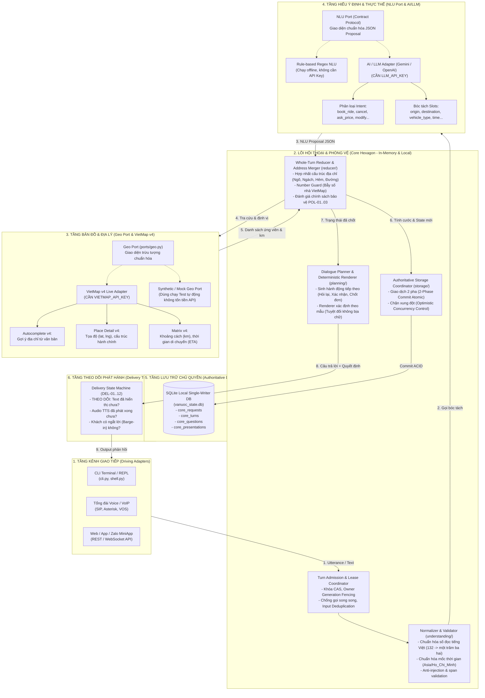
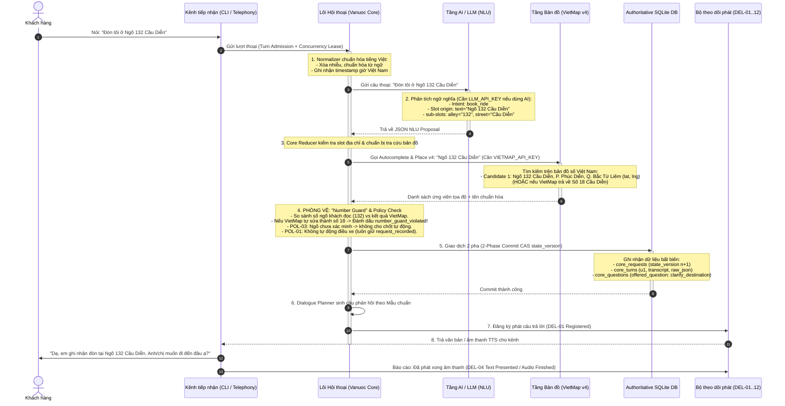
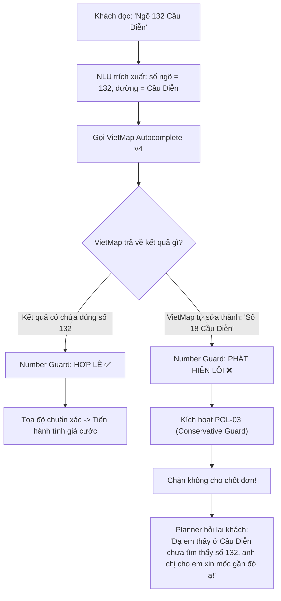

# Sơ Đồ Luồng & Kiến Trúc Toàn Diện Hệ Thống Vanuoc Core v3.0

Tài liệu này hệ thống hóa toàn bộ kiến trúc **Lục giác (Hexagonal Architecture / Ports & Adapters)** và luồng dữ liệu của hệ thống tổng đài đặt xe **ParrotGo / Vanuoc**, làm rõ vị trí, vai trò và ranh giới trách nhiệm của từng thành phần: **AI/LLM (NLU)**, **Bản đồ VietMap v4 (Geo Provider)**, **Lõi Hội thoại & Phòng vệ (Core Reducer & SQLite)**, và **Giao diện/Tổng đài (Telephony/CLI)**.

---

## 1. Sơ Đồ Kiến Trúc Tổng Thể (Hexagonal Architecture)

Biểu đồ dưới đây thể hiện sự độc lập của **Lõi Hội thoại (Domain Core)** với các dịch vụ bên ngoài (AI, VietMap, DB, Tổng đài) thông qua các **Ports & Adapters**:

---

## 2. Luồng Xử Lý Chi Tiết Từng Lượt Thoại (Sequence Flow)

Ví dụ thực tế: Khách hàng gọi đến đọc: **"Đón tôi ở Ngõ 132 Cầu Diễn"**

---

## 3. Bản Đồ Ranh Giới & Khóa Truy Cập (API Keys & Dependencies)

Bảng tổng hợp giúp phân biệt chính xác chức năng nào nằm ở file nào, và cần cấu hình API Key gì:

| Tầng Chức Năng | Thành Phần Triển Khai | Thư Mục Mã Nguồn | Cần API Key Gì? | Ghi Chú An Toàn & Vận Hành |
| :--- | :--- | :--- | :--- | :--- |
| **1. Kênh tiếp nhận** | CLI REPL, Sip Trunking, Webhook | `src/conversation/adapters/cli/`, `cli.py` | Không | Nhận audio/text từ khách, chuyển giao cho Lõi. |
| **2. Tầng Hiểu Ý Định (NLU)** | AI Prompt, LLM Tool Calling, Rule Regex | `src/conversation/understanding/` | **LLM_API_KEY** *(Tùy chọn)* | • Nếu có API Key (Gemini/OpenAI): bóc tách câu nói phức tạp. • Nếu không có: Fallback sang Rule-based/Mock test. |
| **3. Tầng Bản Đồ (Geo Provider)** | **VietMap v4 Adapter** (Autocomplete, Place, Matrix) | `src/conversation/ports/geo.py` | **VIETMAP_API_KEY** *(Cần khi chạy thật)* | • **VietMap nằm ở đây!** • Chịu trách nhiệm tìm ngõ/hẻm, tính km cước xe. • Trong lúc test tự động: dùng Mock Geo Port không tốn tiền. |
| **4. Lõi Hội Thoại (Domain Core)** | Whole-turn Reducer, Address Merger, Number Guard | `src/conversation/domain/`, `src/conversation/reducer/` | **Không cần API Key** | • **Trọng tài tối cao của hệ thống.** • Bắt bẫy sai số nhà của VietMap. • Thực thi chính sách bảo vệ tài xế (POL-01, 02, 03). |
| **5. Cơ Sở Dữ Liệu Chủ Quyền** | Single-Writer Coordinator, SQLite Store | `src/conversation/storage/` | **Không cần API Key** | • File SQLite nội bộ cục bộ máy chủ (`.db`). • Lưu trữ trạng thái phiên (CAS state_version, lock generation). |
| **6. Lập Kế Hoạch & Phản Hồi** | Dialogue Planner, Deterministic Renderer | `src/conversation/planning/` | **Không cần API Key** | • Không cho AI tự biên tự diễn câu nói. • Mọi câu trả lời đều theo template kiểm soát nghiêm ngặt. |
| **7. Quản Lý Phát Hành** | Delivery Tracker State Machine (DEL-01..12) | `src/conversation/delivery/` | **Không cần API Key** | • Theo dõi khách đã nghe thấy câu hỏi chưa để xử lý ngắt lời (Barge-in). |

---

## 4. Cơ Chế "Number Guard" (Bẫy VietMap) Hoạt Động Ra Sao?

VietMap rất thông minh nhưng khi người dùng đọc **ngõ/ngách sâu** (ví dụ: `Ngõ 132 Cầu Diễn`), nếu dữ liệu bản đồ chỉ có `Số 18 Cầu Diễn`, VietMap API có thể tự động trả về số nhà gần nhất:

---

## 5. Tóm Lại:
1. **VietMap** là một **External Driven Port (Tầng Bản đồ)**: Nhiệm vụ duy nhất là **tìm kiếm địa chỉ, lấy tọa độ và tính km/thời gian**.
2. **VietMap KHÔNG ra quyết định hội thoại**: Việc khách nói gì, hỏi lại cái gì, có chốt đơn hay không hoàn toàn do **Lõi Hội Thoại (Core Reducer & Planner)** quyết định.
3. **Core Reducer luôn giám sát VietMap**: Nhờ có `Number Guard` và `POL-01..03`, hệ thống ngăn chặn triệt để tình trạng tài xế chạy đến nhầm địa chỉ do lỗi gợi ý sai của bản đồ.
